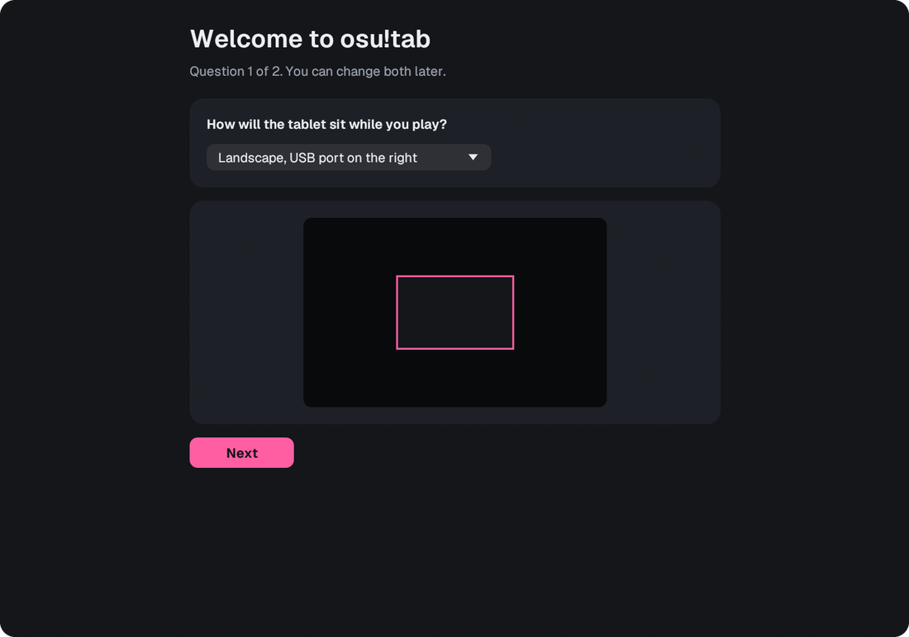
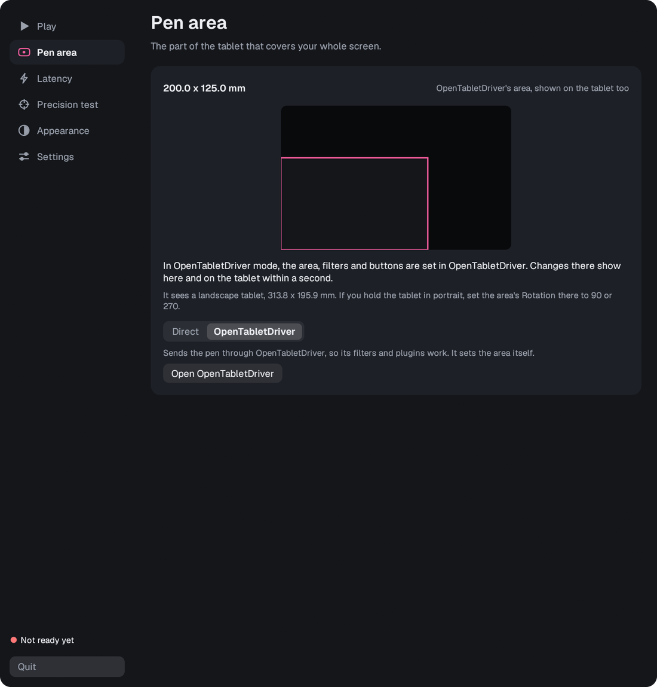
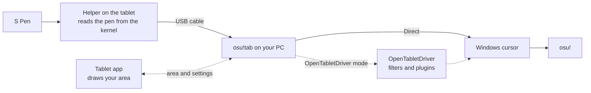

<p align="center">
  
</p>

<h1 align="center">osu!tab</h1>

<p align="center">
  <strong>Play osu! with a Samsung Galaxy Tab and its S Pen, as a low-latency pen tablet.</strong><br>
  Free. USB only. No root, no driver to install and nothing to download from Google.
</p>

<p align="center">
  
  
  
  
  
  
</p>

<p align="center">
  <a href="#download">Download</a> ·
  <a href="#quick-start">Quick start</a> ·
  <a href="docs/GUIDE.md">Guide</a> ·
  <a href="CHANGELOG.md">Changelog</a> ·
  <a href="#help-test-osutab">Help test it</a>
</p>

<p align="center">
  
</p>

> [!IMPORTANT]
> **osu!tab is in beta.** It has only been tested on a **Samsung Galaxy Tab S8 Ultra** with the **S Pen that comes in the box**, playing **osu!lazer** on Windows 11. If you have a different Samsung tablet, or play osu!stable, please try it and tell us how it went. See [Help test osu!tab](#help-test-osutab).

## What it does

A Galaxy Tab with an S Pen is a large, accurate pen surface. osu!tab turns it into an osu! tablet: plug it into your PC with a USB cable, and the pen moves your cursor with well under a millisecond of added delay.

The pen is read on the tablet before Android touches it, sent over the cable, and placed exactly where the pen says. Nothing smooths, predicts or accelerates it on the way.

## Features

| | |
|---|---|
| ⚡ **Fast** | About 0.5 ms of added latency, and under 1 ms for 99% of reports even with every CPU core busy. |
| 🎯 **Accurate** | Absolute and one-to-one, aimed at the middle of the right pixel. The pen and the cursor always agree. |
| 🚀 **Quick to start** | The pen works about 0.15 s after launch, and comes back in about 0.3 s if the connection drops. |
| 📦 **Nothing else to install** | One download. osu!tab sets up the tablet itself, with no adb.exe, platform-tools or drivers. |
| 🖐️ **Your area, on the tablet** | The tablet shows your pen area. Move and resize it with your fingers, or set it on the PC. |
| 🛡️ **Palm friendly** | The tablet app takes every touch, so a resting palm can't open anything. |
| ✅ **Checks before you play** | The Play tab spots common problems, such as lazer settings and apps known to cause stutters. |
| 📊 **Live numbers** | See how long each pen report takes, stage by stage, and test the cursor's accuracy. |
| 🎨 **Themes** | Five themes, or your own colors, on both the PC and the tablet. |
| 🧩 **OpenTabletDriver mode** | An optional mode for OpenTabletDriver's filters and plugins, with its area shown on the tablet too. |

## Screenshots

<table>
  <tr>
    <td width="50%"></td>
    <td width="50%"></td>
  </tr>
  <tr>
    <td align="center">Your pen area, on the tablet</td>
    <td align="center">Hold the circle, then move and resize it with your fingers</td>
  </tr>
  <tr>
    <td width="50%"></td>
    <td width="50%"></td>
  </tr>
  <tr>
    <td align="center">Size, position, rotation and presets</td>
    <td align="center">Live latency, stage by stage (simulated reports shown)</td>
  </tr>
  <tr>
    <td width="50%"></td>
    <td width="50%"></td>
  </tr>
  <tr>
    <td align="center">Pick a theme or make your own</td>
    <td align="center">Light themes too</td>
  </tr>
  <tr>
    <td width="50%"></td>
    <td width="50%"></td>
  </tr>
  <tr>
    <td align="center">Two questions to get started</td>
    <td align="center">OpenTabletDriver mode shows its own area</td>
  </tr>
</table>

## Download

Get **`osu-tab-1.0.0-beta.1-windows-x64.zip`** from the [Releases](https://github.com/unlimiteq/osu-tab/releases) page, unzip it anywhere and run **`osu!tab.exe`**. There's no installer.

| In the zip | What it's for |
|---|---|
| `osu!tab.exe` | The program. The tablet helper and tablet app are built in. |
| `otd\` | OpenTabletDriver, used only in OpenTabletDriver mode. |
| `README.md`, `CHANGELOG.md`, `docs\` | This page, the changelog and the full guide. |
| `LICENSE-Geist-font.txt` | The license for the font both apps use. |

> [!NOTE]
> osu!tab isn't code-signed yet, so Windows may say **"Windows protected your PC"** the first time. Click **More info**, then **Run anyway**. A `.sha256` file on the release page lets you check the download.

### What you need

| | |
|---|---|
| **PC** | Windows 11, 64-bit. Windows 10 is untested. |
| **Tablet** | A Samsung Galaxy Tab S8 Ultra with its S Pen. Other Samsung tablets are untested. |
| **Cable** | A USB cable that carries data, not one that only charges. |
| **Game** | osu!lazer. osu!stable is untested. |
| **Optional** | The [.NET 10 Desktop Runtime](https://dotnet.microsoft.com/download/dotnet/10.0), only for OpenTabletDriver mode. |

## Quick start

1. **Turn on USB debugging on the tablet.** Open Settings > About tablet > Software information and tap **Build number** seven times. Then open Settings > Developer options and turn on **USB debugging**.
2. **Plug the tablet into your PC** with a data cable.
3. **Run `osu!tab.exe`** and answer its two questions: how the tablet sits, and how big your pen area should be.
4. **Tap Allow on the tablet** when it asks "Allow USB debugging?", and tick **Always allow from this computer**. The Play tab tells you when it's waiting for this. The first connection also installs the osu!tab app on the tablet, which takes a few seconds.
5. **In osu!lazer**, turn off **High precision mouse** (Settings > Input > Mouse).

When the Play tab says **Ready to play**, you're set. Closing the window keeps osu!tab running in the tray, and **Quit** gives the pen back to Android.

## How it works



A small helper runs on the tablet through Android's USB debugging connection, so no root is needed. It reads the S Pen straight from the Linux kernel, before Android processes it, and sends each report over the cable. On the PC, osu!tab speaks the debugging protocol over USB itself, so Google's adb.exe isn't needed, and it places the cursor with Windows' `SendInput`.

The tablet app only draws your pen area and handles finger edits. It isn't in the pen's path, so it can't slow the pen down.

## How fast is it?

Measured on the test setup, over direct USB:

| | Result |
|---|---|
| Launch to pen working | about 0.15 s |
| Back after a dropped connection | 0.26 to 0.32 s |
| Added latency, median | about 0.5 ms (about 0.7 ms in a real S Pen session) |
| Added latency, 99th percentile | 0.7 to 0.8 ms, with the PC idle or every core busy |
| S Pen report rate | about 480 per second |

Added latency runs from the tablet registering a pen event to the PC finishing the cursor move. It doesn't include the pen's own hardware, the game or your display, and your numbers will depend on your hardware. The guide has [the full results](docs/GUIDE.md#reading-the-latency-numbers).

## Compatibility

| | Status |
|---|---|
| Samsung Galaxy Tab S8 Ultra (SM-X900) with the S Pen in the box | ✅ Tested |
| osu!lazer | ✅ Tested |
| Windows 11 | ✅ Tested |
| Other Samsung tablets with an S Pen | ❓ Untested. [Help wanted](#help-test-osutab) |
| osu!stable | ❓ Untested. [Help wanted](#help-test-osutab) |
| Windows 10 | ❓ Untested |
| Android tablets from other brands | ❓ Untested, and likely to need changes |
| OpenTabletDriver community plugins | ❓ Untested |

## Help test osu!tab

So far osu!tab has run on one setup. If you have another Samsung tablet with an S Pen, or you play osu!stable, a report helps a lot, whether it works or not.

1. Follow the [Quick start](#quick-start) and play for a bit.
2. Open a **[compatibility report](https://github.com/unlimiteq/osu-tab/issues/new?template=compatibility-report.yml)**. It asks for your tablet's model number, its Android and One UI versions, your Windows version, which osu! you play, and what worked.
3. If you can, attach the latency log from that run. The Latency tab's **Open the logs folder** button finds it.

Found a bug instead? Open a **[bug report](https://github.com/unlimiteq/osu-tab/issues/new?template=bug-report.yml)**.

> [!NOTE]
> osu!tab assumes the S8 Ultra's screen size, 313.8 × 195.9 mm. On another tablet the sizes it shows in mm will be off, and other things may need changes too.

## Recommended osu!lazer settings

| Setting | Value |
|---|---|
| Input > Mouse > High precision mouse | **Off**. When on, lazer uses relative movement, so jumps won't land under the pen. osu!tab warns you. |
| Input > Mouse > Disable mouse buttons during gameplay | Your choice. When on, hit with Z/X or the pen's side button. |
| Graphics > Frame limiter | Unlimited has the least delay. osu!tab warns about VSync. |
| Graphics > Screen mode | Fullscreen has the least delay. |

More, including osu!stable and Windows, is in the [guide](docs/GUIDE.md#osu-settings).

## Tips

- **Close anything you don't need before you play.** Overlays, animated wallpapers, mouse and lighting software and other desktop utilities can make Windows hold up the cursor now and then. In testing, closing a few took the worst delay during play from 91.6 ms to 16.8 ms. The Play tab names apps known to cause this, and says when Windows held up the cursor and which program was in front.
- **Start with a smaller pen area.** It needs less arm movement and feels faster. At 120 × 75 mm, 1 mm of pen movement is 21.3 px on a 2560 × 1600 screen.
- **Use a good cable**, ideally in a USB 3 port. The Settings tab shows the link speed.
- **Turn on Pin the app** if your palm keeps finding the Home button. Quitting osu!tab then sends the tablet to its lock screen.

## Good to know

- While osu!tab runs, it holds the pen, so the pen doesn't work on the tablet itself. Quit osu!tab to give it back.
- Android's palm rejection is off while osu!tab holds the pen, but the tablet app takes every touch.
- Android doesn't let an ordinary app block the system bars completely. A swipe from the edge can bring them back for a moment, and **Pin the app** blocks Home and Back. When it pins the app, Android resets the USB connection once, and osu!tab reconnects within a second.
- Quitting osu!tab also closes the tablet app.
- USB debugging gives a connected PC deep access to the tablet, so only allow PCs you trust.

## Troubleshooting

| Problem | What to do |
|---|---|
| "Tablet not found" | Use a cable that carries data, and check USB debugging is on. Still not found? Install Samsung's [Android USB Driver for Windows](https://developer.samsung.com/android-usb-driver). |
| "Waiting for your OK on the tablet" | Tap **Allow** on the tablet. No prompt? Replug the cable with the tablet unlocked. |
| "Windows protected your PC" | Click **More info**, then **Run anyway**. |
| Jumps don't land under the pen | Turn off High precision mouse in lazer. |
| Occasional stutters | Close background apps. The Play tab says which program was in front. |
| OpenTabletDriver mode doesn't start | Install the [.NET 10 Desktop Runtime](https://dotnet.microsoft.com/download/dotnet/10.0). |

The [guide](docs/GUIDE.md#troubleshooting) has more.

## Learn more

The **[full guide](docs/GUIDE.md)** covers every setting, the side button, themes, OpenTabletDriver mode, detailed latency numbers, command-line options and where files are kept. The **[changelog](CHANGELOG.md)** lists what changed in each version.

<details>
<summary><strong>Building from source</strong></summary>

<br>

You'll need [Rust](https://rustup.rs), the [.NET 10 SDK](https://dotnet.microsoft.com/download), Java 21, Gradle 8.11 and the Android SDK (platform 35, build-tools 35). `build.ps1` looks for the last three in `tools\jdk21`, `tools\gradle` and `tools\android-sdk`, and fetches OpenTabletDriver's source into `tools\otd-src`.

```powershell
rustup target add aarch64-unknown-linux-musl
.\build.ps1             # builds everything into target\
.\package.ps1           # a ready-to-run copy in dist\osu!tab
.\package.ps1 -Zip      # the release zip and its SHA-256
cargo test              # the PC program's tests
```

The repository has three Rust crates: `core` (the shared wire format), `helper` (runs on the tablet) and `host` (the Windows program). The tablet app is in `android`, and the OpenTabletDriver bridge plugin in `otd-plugin`.

</details>

## Credits

- [OpenTabletDriver](https://github.com/OpenTabletDriver/OpenTabletDriver) powers the optional plugin mode (LGPL-3.0, included in the download with its license).
- [egui](https://github.com/emilk/egui) draws the PC window.
- [Geist](https://github.com/vercel/geist-font) is the typeface in both apps (SIL Open Font License).

osu!tab is an independent project. It isn't affiliated with or endorsed by ppy, osu!, Samsung or Google.

## License

osu!tab doesn't have a license yet, so all rights are reserved for now. The third-party parts above keep their own licenses.
