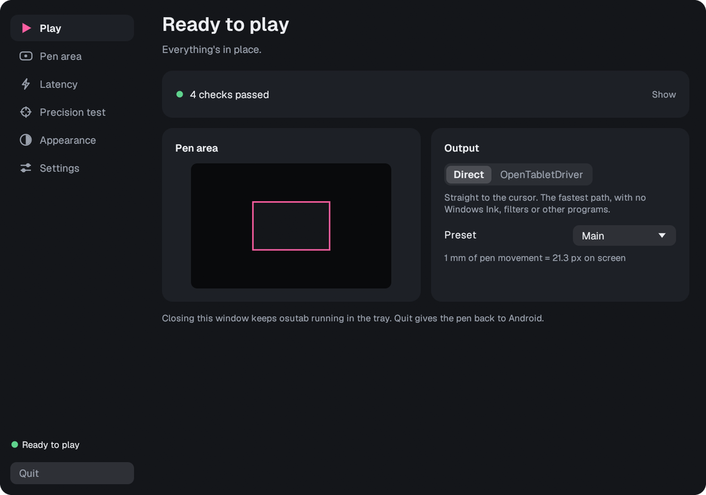
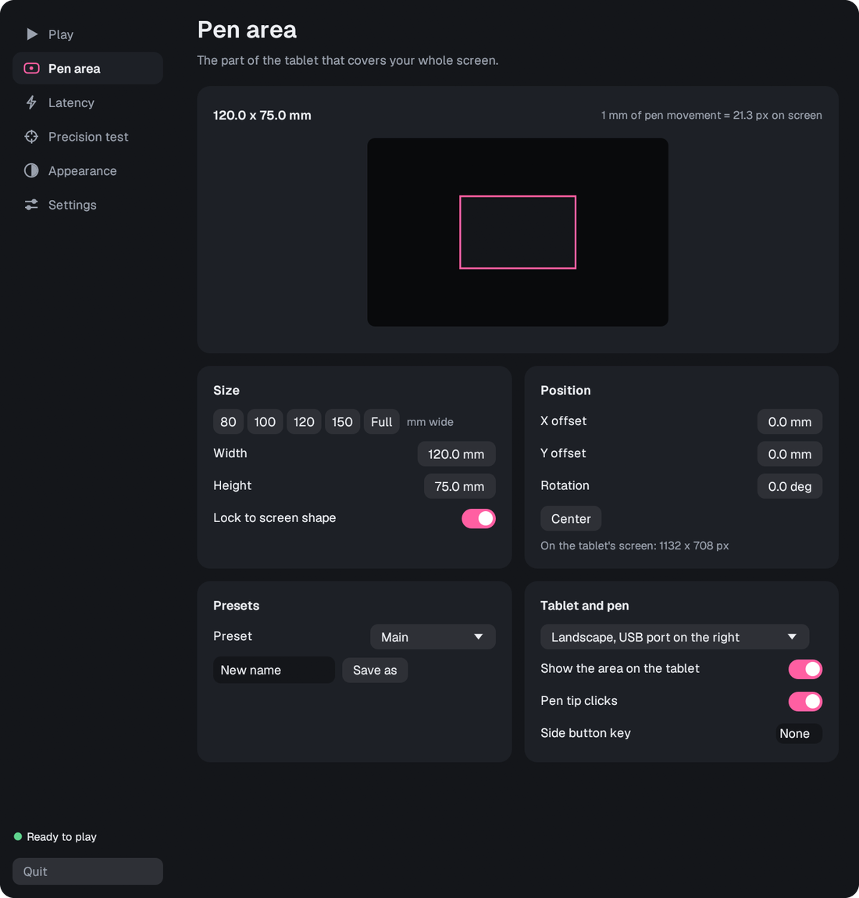
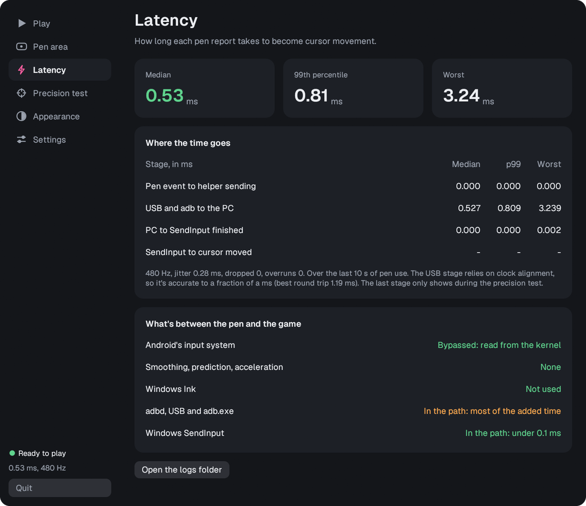
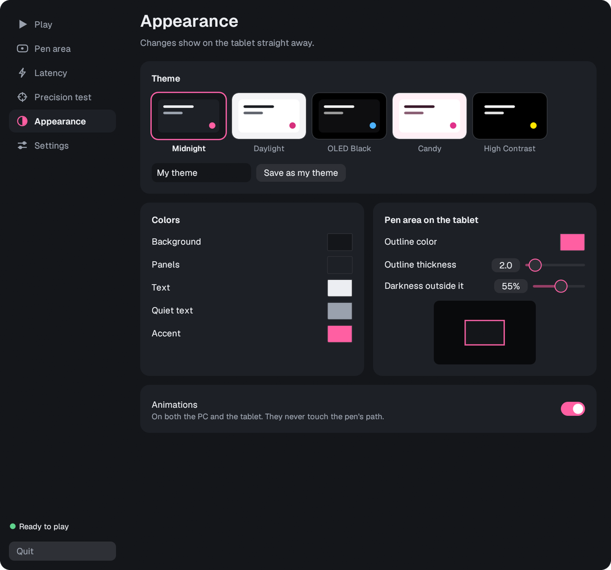
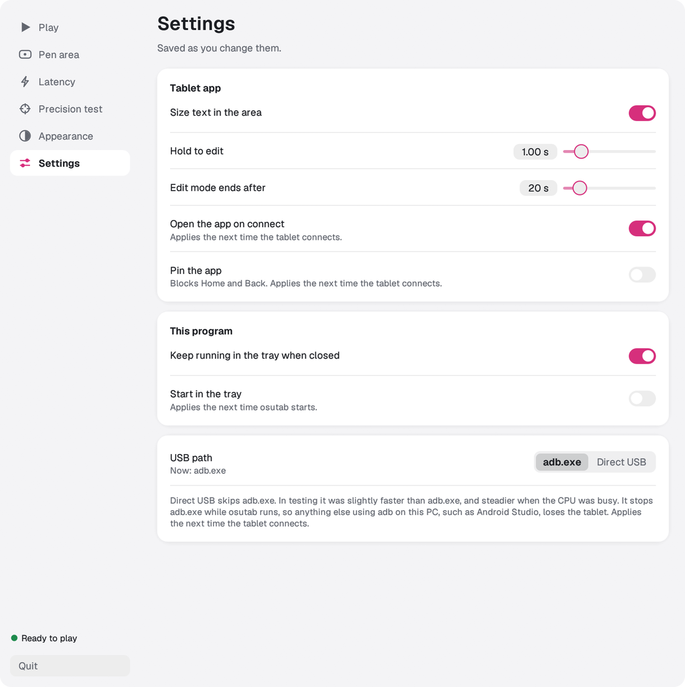
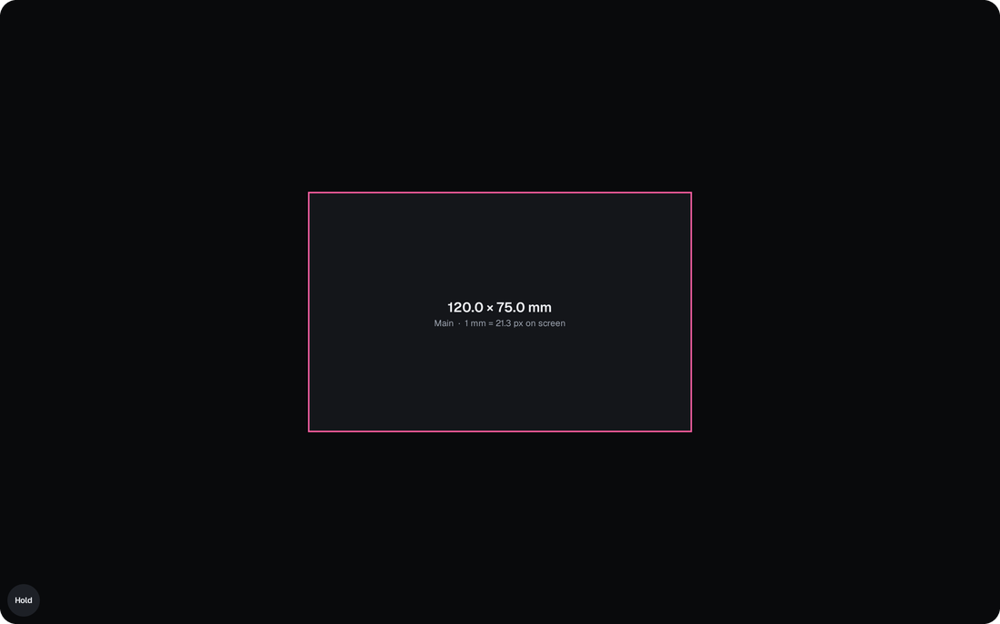
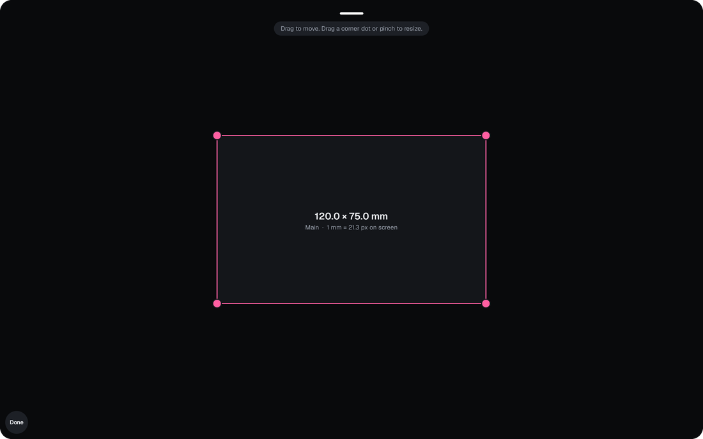
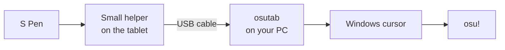

<p align="center">
  
</p>

<h1 align="center">osutab</h1>

<p align="center">
  <strong>Use a Samsung tablet and S Pen as a low-latency pen tablet for osu!</strong><br>
  Free. USB only. No root and no kernel driver.
</p>

<p align="center">
  
  
  
  
  
</p>

<p align="center">
  
</p>

## What it does

If you already own a Samsung tablet with an S Pen, you already own a very good drawing surface. osutab lets you play osu! on it. Plug the tablet into your PC, and the pen moves your cursor with no noticeable delay.

It reads the pen directly on the tablet, sends each report over the USB cable and places the cursor exactly where the pen says. There's no smoothing, no prediction and no acceleration in the way.

> [!IMPORTANT]
> osutab is an early project. It has only been tested with a **Samsung Galaxy Tab S8 Ultra** and **osu!lazer** on Windows. Compatibility with anything else is still unknown. See [Compatibility](#compatibility).

## Features

- **Fast:** under 1 ms of added latency in testing, and it stays steady when your PC is busy.
- **Accurate:** absolute, one-to-one positioning. Pen position and cursor position always agree.
- **Simple setup:** two questions, then a checklist that tells you what's left to do.
- **Your pen area, shown on the tablet:** set its size and position on the PC, or move and resize it with your fingers.
- **Palm friendly:** the tablet app takes every touch, so a resting palm can't open anything inside it.
- **Live numbers:** see how long each pen report takes, stage by stage, and check the cursor's accuracy.
- **Looks how you like:** five themes that apply to both the PC and the tablet, plus your own colors.
- **Works with OpenTabletDriver:** an optional mode for its filters and plugins.
- **Recovers by itself:** unplug and replug, or change your resolution, and it carries on.

## Screenshots

<table>
  <tr>
    <td width="50%"></td>
    <td width="50%"></td>
  </tr>
  <tr>
    <td align="center">Set the size and position of your pen area</td>
    <td align="center">Live latency, by stage (simulated reports shown)</td>
  </tr>
  <tr>
    <td width="50%"></td>
    <td width="50%"></td>
  </tr>
  <tr>
    <td align="center">Choose a theme or make your own</td>
    <td align="center">Light themes too</td>
  </tr>
  <tr>
    <td width="50%"></td>
    <td width="50%"></td>
  </tr>
  <tr>
    <td align="center">Your pen area, on the tablet</td>
    <td align="center">Move and resize it with your fingers</td>
  </tr>
</table>

## How it works



A small helper runs on the tablet through Android's debugging connection, so no root is needed. It reads the pen directly from the system, before Android processes it. The tablet app only draws your pen area and handles finger edits, so it isn't in the pen's path and can't slow it down.

## Compatibility

| | Status |
|---|---|
| Samsung Galaxy Tab S8 Ultra with S Pen | ✅ Tested |
| osu!lazer | ✅ Tested |
| Windows 11 | ✅ Tested |
| Other Samsung tablets and S Pen devices | ❓ Unknown. Some values are specific to the S8 Ultra, so they may need changes. |
| Other Android tablets with a pen | ❓ Unknown |
| osu!stable | ❓ Unknown |
| Other games and drawing apps | ❓ Unknown |
| Windows 10 | ❓ Unknown |
| OpenTabletDriver community plugins | ❓ Unknown |

If you try osutab on something else, please share how it went by opening an issue.

## Getting started

There are no ready-made downloads yet, so for now you'll need to build it yourself.

### 1. Build it

You'll need [Rust](https://rustup.rs), the [.NET 10 SDK](https://dotnet.microsoft.com/download), Java 21, Gradle 8.11, the Android SDK (platform 35) and Google's [platform-tools](https://developer.android.com/tools/releases/platform-tools). Put the last four inside a `tools` folder, as the [guide](docs/GUIDE.md#building-from-source) describes.

```powershell
rustup target add aarch64-unknown-linux-musl
.\package.ps1
```

The finished program is in `dist\osutab`.

### 2. Set up the tablet

Turn on **USB debugging**. Go to Settings > About tablet > Software information and tap Build number seven times. Then go to Settings > Developer options and turn on USB debugging.

### 3. Connect and run

1. Connect the tablet to your PC with a USB cable that carries data.
2. Run `osutab.exe` and answer its two questions: how the tablet sits, and how big the pen area should be.
3. On the tablet, tap **Allow** on the USB debugging prompt, and approve the osutab app if Android asks.
4. In osu!lazer, turn off **High precision mouse** (Settings > Input > Mouse).

The **Play** page checks all of this. When it says **Ready to play**, you're set.

## Tips for the best experience

- **Close anything you don't need.** Background apps, overlays and desktop utilities can all cause occasional delays. osutab warns you about some known ones.
- **Start with a smaller pen area.** A smaller area needs less arm movement and feels faster. Try around 100 to 120 mm wide.
- **Match your screen's shape.** A stretched area makes movement uneven. osutab warns you and offers a fix.
- **Use a good cable.** Some cables only charge, and those won't work at all.
- **Try Direct USB.** It's on the Settings page, and it was the fastest and steadiest connection in testing.

## How fast is it?

| Measured on the test setup | Median |
|---|---|
| Real S Pen session | about 0.7 ms |
| Simulated pen reports, PC idle | about 0.5 ms |
| Simulated pen reports, all CPU cores busy | about 0.5 ms |

This is the time from the tablet registering a pen event to the PC finishing the cursor move. It doesn't include the pen's own hardware, the game or your display, and your results will depend on your hardware. The S Pen itself reports about 480 times a second. The guide has [the full numbers](docs/GUIDE.md#reading-the-latency-numbers).

## Good to know

- While osutab runs, it holds the pen, so the pen won't work on the tablet itself. Quit osutab to give it back.
- Android's own palm rejection is off during this time, though the tablet app still takes every touch.
- Android doesn't let an ordinary app fully block the system bars. A swipe from the screen's edge can bring them back for a moment, and there's an optional setting to pin the app.
- USB debugging gives a connected PC deep access to your tablet, so only allow PCs you trust.

## Learn more

The **[full guide](docs/GUIDE.md)** covers every setting, recommended osu! settings, OpenTabletDriver mode, troubleshooting, detailed latency numbers, command-line options and building from source.

## Credits

- [OpenTabletDriver](https://github.com/OpenTabletDriver/OpenTabletDriver) powers the optional plugin mode (LGPL-3.0).
- [egui](https://github.com/emilk/egui) draws the PC interface.
- [Geist](https://github.com/vercel/geist-font) is the typeface in both apps (SIL Open Font License, included in `assets/fonts`).
- Google's Android platform-tools provide the connection to the tablet. They aren't included in this repository.

osutab is an independent project. It isn't affiliated with or endorsed by osu!, ppy, Samsung or Google.

## License

osutab doesn't have a license yet, so all rights are reserved for now. The third-party parts above keep their own licenses.
