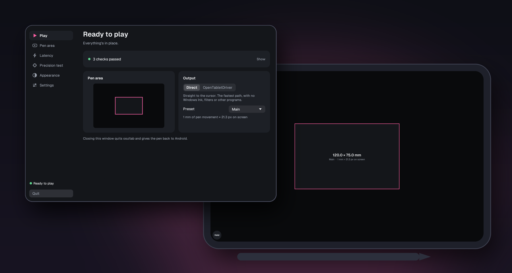
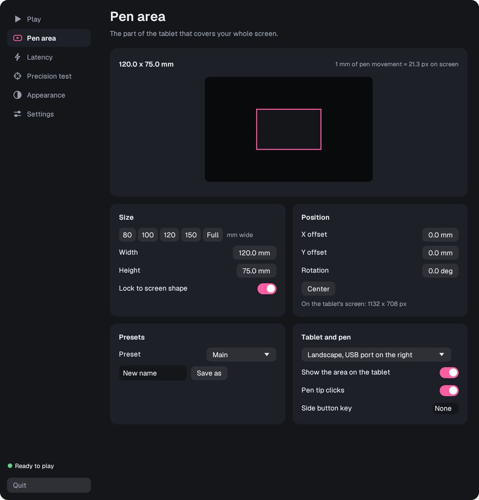
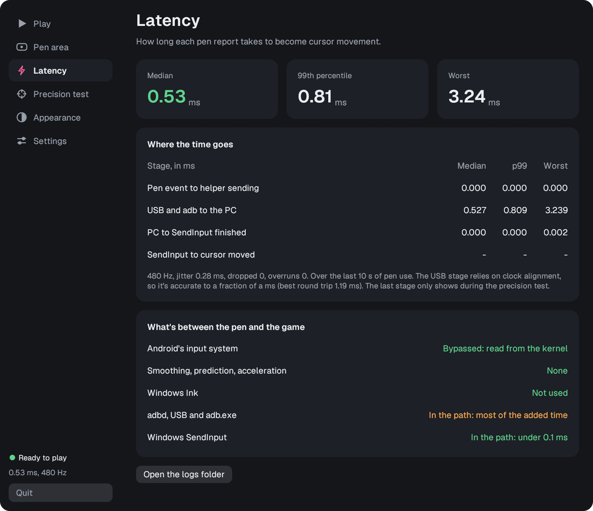
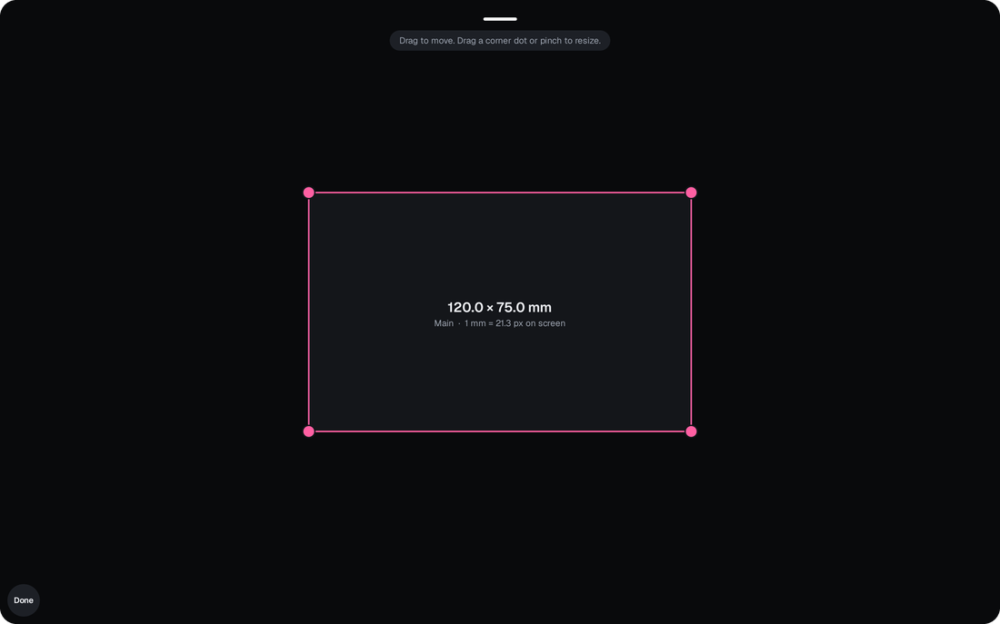
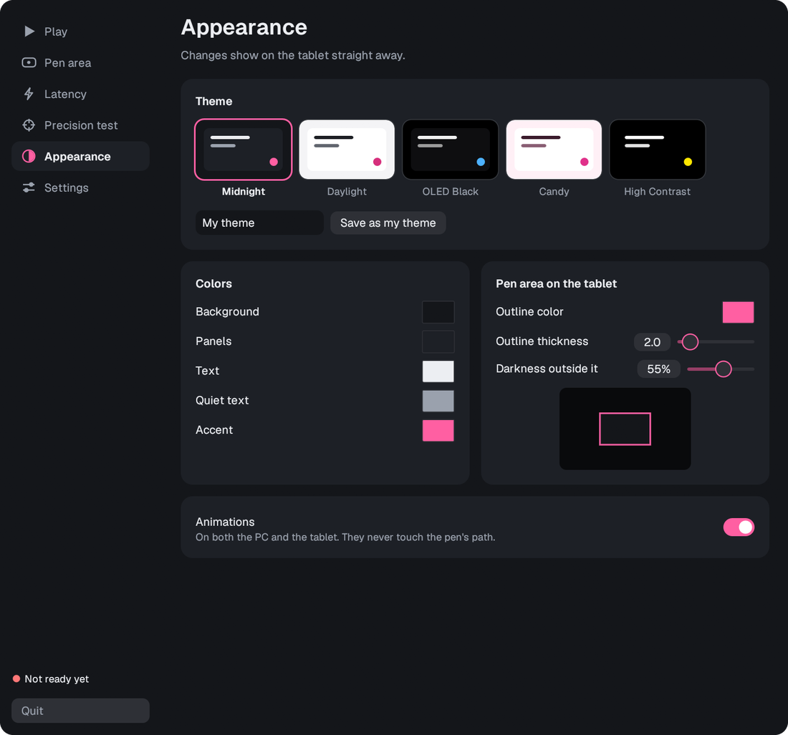

<p align="center">
  
</p>

<h1 align="center">osu!tab</h1>

<p align="center">
  Play osu! with a Samsung Galaxy Tab and its S Pen as a pen tablet, over USB.<br>
  Free, no root, nothing to install on the tablet yourself.
</p>

<p align="center">
  <a href="https://github.com/unlimiteq/osutab/releases/latest"></a>
  <a href="docs/GUIDE.md"></a>
  <a href="https://github.com/unlimiteq/osutab/issues/new?template=compatibility-report.yml"></a>
  <a href="https://github.com/unlimiteq/osutab/stargazers"></a>
</p>

<p align="center">
  
</p>

osu!tab reads the S Pen on the tablet before Android touches it, sends each report over the USB cable, and puts the cursor exactly where the pen is. In my testing that adds about 0.5 ms of latency, under 1 ms for 99% of reports. The pen works about 0.15 s after launch.

It has only been tested on a **Galaxy Tab S8 Ultra** with the S Pen in the box, playing **osu!lazer** on **Windows 11**. If you have another Samsung tablet, or play osu!stable, please try it and [tell me how it went](#contributing).

## Features

- Absolute, one-to-one cursor, with no smoothing or acceleration unless you turn on the optional filters.
- The tablet shows your pen area full screen. Move and resize it with your fingers, or set it on the PC.
- The tablet app takes every touch, so a resting palm can't open anything.
- The pen's side button can be any key, or a combination for hotkeys.
- The Play tab checks for common problems, such as lazer's High precision mouse and apps known to cause stutters.
- Live latency numbers and a precision test.
- Themes on both the PC and the tablet.
- An optional OpenTabletDriver mode, if you want its filters and plugins.

## Screenshots

<table>
  <tr>
    <td width="50%"></td>
    <td width="50%"></td>
  </tr>
  <tr>
    <td align="center"><b>Pen area</b><br>Size, position, rotation and presets</td>
    <td align="center"><b>Latency</b><br>Live numbers, stage by stage</td>
  </tr>
  <tr>
    <td width="50%"></td>
    <td width="50%"></td>
  </tr>
  <tr>
    <td align="center"><b>On the tablet</b><br>Hold, then move and resize the area with your fingers</td>
    <td align="center"><b>Themes</b><br>Five built in, or your own colors</td>
  </tr>
</table>

## Installation

Get `osu-tab-1.0.0-windows-x64.zip` from [Releases](https://github.com/unlimiteq/osutab/releases), unzip it anywhere and run `osu!tab.exe`. There's no installer, and no adb.exe or drivers to set up.

You need Windows 11 (64-bit), the tablet and its S Pen, and a USB cable that carries data. OpenTabletDriver mode also needs the [.NET 10 Desktop Runtime](https://dotnet.microsoft.com/download/dotnet/10.0).

osu!tab isn't code-signed yet, so Windows may say "Windows protected your PC" the first time. Click **More info**, then **Run anyway**. The release has a `.sha256` file if you want to check the download.

## Usage

1. On the tablet, turn on **USB debugging**: tap Settings > About tablet > Software information > **Build number** seven times, then turn it on in Settings > Developer options. USB debugging gives the connected PC deep access to the tablet, so only allow PCs you trust.
2. Plug the tablet into the PC and run `osu!tab.exe`. Answer its two questions: how the tablet sits, and how big your pen area should be.
3. Tap **Allow** when the tablet asks "Allow USB debugging?", and tick **Always allow from this computer**. The first connection installs the osu!tab app on the tablet.
4. In osu!lazer, turn off **High precision mouse** (Settings > Input > Mouse).

When the Play tab says **Ready to play**, you're set. Closing the window keeps osu!tab in the tray, and **Quit** gives the pen back to Android.

The [guide](docs/GUIDE.md) covers every setting, osu! and Windows settings, the filters, OpenTabletDriver mode, how it works, the full latency numbers, an [FAQ](docs/GUIDE.md#faq) and troubleshooting.

## Is this allowed in osu!?

osu!tab is an input device, like a Wacom driver or OpenTabletDriver. It puts the cursor where the pen is and doesn't aim, slow the game down or play anything for you.

- **The filters** are the same kind many players already run through OpenTabletDriver, such as radial follow. They steady jitter and add a little lag rather than helping you aim, and they're off by default. osu!'s rules don't mention tablet drivers or filters either way, so leave them off if you'd rather be safe.
- **The side button** follows the same rule as any key: one press should be one press of one game key. Binding it to K1 or K2 is fine. Don't bind it to K1 and K2 together, because osu!'s rules don't allow one physical press to send more than one key press.

See osu!'s [rules](https://osu.ppy.sh/wiki/en/Rules), and ask osu! support if in doubt.

## Contributing

So far osu!tab has run on one setup, so any report helps, whether it works or not. Open a [compatibility report](https://github.com/unlimiteq/osutab/issues/new?template=compatibility-report.yml) with your tablet model, Android and One UI versions, Windows version and which osu! you play. If you can, attach the latency log (the Latency tab's **Open the logs folder** button finds it). For anything broken, open a [bug report](https://github.com/unlimiteq/osutab/issues/new?template=bug-report.yml). Code changes are welcome too; see [CONTRIBUTING.md](CONTRIBUTING.md).

osu!tab assumes the S8 Ultra's screen size, so on another tablet the sizes it shows in mm will be off.

What's planned next is on the [1.1.0 roadmap](https://github.com/unlimiteq/osutab/milestone/1). Issues marked [good first issue](https://github.com/unlimiteq/osutab/labels/good%20first%20issue) are a good place to start, and security problems go through [SECURITY.md](SECURITY.md), not a public issue.

## Building and testing

You'll need [Rust](https://rustup.rs), the [.NET 10 SDK](https://dotnet.microsoft.com/download), Java 21, Gradle 9.6 and the Android SDK (platform 35, build-tools 36). See the [guide](docs/GUIDE.md#building-from-source) for where `build.ps1` looks for them.

```powershell
rustup target add aarch64-unknown-linux-musl
.\build.ps1             # builds everything into target\
.\package.ps1 -Zip      # dist\osu!tab, plus the release zip
cargo test              # runs the PC program's tests
```

Every push runs the tests, rustfmt, clippy and CodeQL on GitHub Actions.

`crates/core` is the shared wire format, `crates/helper` runs on the tablet, `crates/host` is the Windows program, `android` is the tablet app and `otd-plugin` is the OpenTabletDriver bridge.

## License

MIT, see [LICENSE](LICENSE). OpenTabletDriver (LGPL-3.0) is included in the download with its license, the PC window uses [egui](https://github.com/emilk/egui), and both apps use the [Geist](https://github.com/vercel/geist-font) font (SIL Open Font License).

osu!tab is an independent project, not affiliated with or endorsed by ppy, Samsung or Google.
